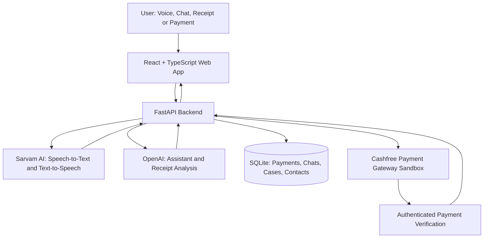
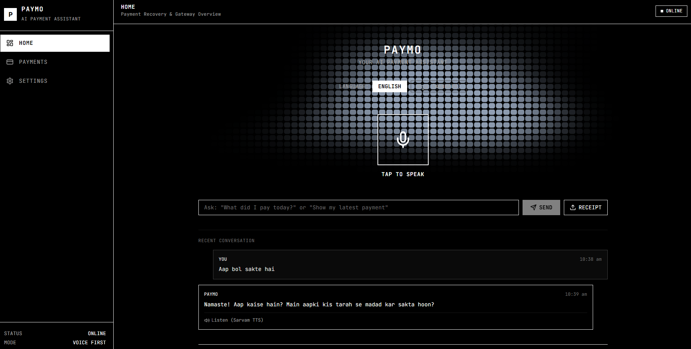
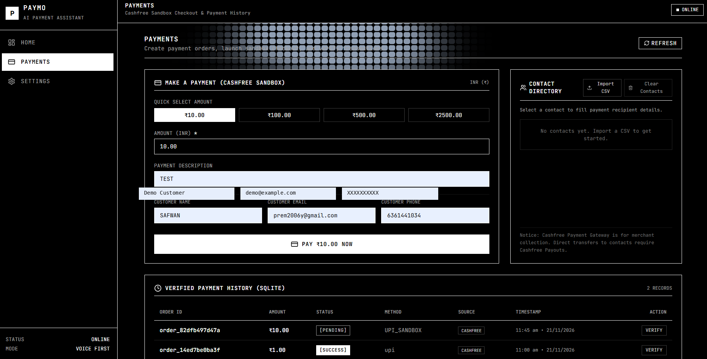

# Paymo

**An AI payment assistant that listens, explains payments, and helps when something goes wrong.**


## The problem

Sometimes money is deducted but an order still says **pending** or **failed**. People may not know if the payment worked, what a receipt means, or how to ask for help. Language can make payment support even harder.

## Our solution

**Paymo** brings payment tracking, an AI assistant, and Indian-language voice support together in one simple application.

- **Ask by voice or text:** Speak in supported languages such as English and Kannada. Sarvam AI handles speech; OpenAI helps explain and investigate.
- **Pay a merchant:** Start a payment through **Cashfree's sandbox checkout** and check its status using the backend.
- **Track payments:** See saved orders, amounts, timestamps, and verified gateway statuses.
- **Understand receipts:** Upload an image or PDF. AI extracts and explains the available details, and Sarvam can speak the summary.
- **Get help:** Ask about the latest payment, a pending transaction, or a possible payment problem. The assistant can help create a support case.

**Important:** Paymo currently uses Cashfree's **sandbox** for demonstration. Sandbox transactions do not send real money. Cashfree Payment Gateway collects merchant payments; transfers directly to contacts require a separate, authorized **Cashfree Payouts** integration. A receipt screenshot alone does not prove a payment succeeded.

## A real-world example

A student pays ₹500 for a service but the website shows **Payment Pending**. The student opens Paymo and asks in Kannada: *“Did my payment go through?”* Paymo checks any matching **authorized Cashfree transaction** and explains the verified status in simple words and speech. If it cannot verify the payment, it says so and helps the student understand what to do next.

## How Paymo works

1. The user speaks, types, uploads a receipt, or starts a merchant payment.
2. **Sarvam AI** converts speech into text and can read responses aloud.
3. **FastAPI** passes the request to **OpenAI** and approved payment/database tools.
4. **Cashfree** creates sandbox checkout orders and provides authenticated order-status checks.
5. **SQLite** stores orders, support cases, contacts, and conversations locally.
6. Paymo shows the result in the interface and, when available, explains it by voice.

## Architecture



## Screenshots

### Home — Voice-first payment assistant



### Payments — Cashfree sandbox checkout and transaction history



## Technology

| Technology | What it does |
| --- | --- |
| React, TypeScript, Vite | Web interface |
| Tailwind CSS | Styling |
| Python, FastAPI | API and business logic |
| SQLite, SQLAlchemy | Local data storage |
| OpenAI API | Conversation, payment explanations, receipt analysis |
| Sarvam AI | Speech-to-text and text-to-speech |
| Cashfree | Merchant checkout and sandbox payment verification |

## Run locally

**You need:** Node.js, Python, and your own API credentials.

```bash
# Terminal 1 — frontend (project root)
npm install
npm run dev
```

```bash
# Terminal 2 — backend (from project root)
cd backend
python -m venv .venv
# Windows: .venv\Scripts\activate
# macOS/Linux: source .venv/bin/activate
pip install -r requirements.txt
uvicorn app.main:app --reload --port 8000
```

Set up a **backend-only** `.env` using the existing `backend/.env.example`, with values appropriate to the current project configuration. Typical variables include `OPENAI_API_KEY`, `SARVAM_API_KEY`, `CASHFREE_APP_ID`, and `CASHFREE_SECRET_KEY`. Keep Cashfree in **sandbox** mode. Apply the project's database migrations before first use if required by the local setup.

- Frontend: `http://localhost:5173`
- Backend API documentation: `http://127.0.0.1:8000/docs`

**Security:** Never commit `.env` files, API keys, SQLite databases, real customer contacts, receipts, or private test data. This project is a hackathon prototype, not a production banking app.

## Project goal

Make payment assistance easier to understand and more accessible through simple language, voice interaction, and reliable transaction information.

**Maintained by [Prem17th](https://github.com/Prem17th).**
